<p align="center">
  
</p>

# HenriWorks Engineering Harness 0.1.2

> Harness do GitHub Copilot no VS Code que leva uma intenção até a PR, em backend, BFF ou frontend, de
> qualquer stack. Cada fase tem um agente, cada procedimento é um comando `/hwk-*`, cada portão é um
> script ou uma pessoa, e nenhuma revisão é feita por quem escreveu. Sucede o HenriSpec 0.4.5 e o HenriSpec Discovery 0.3.1, num pacote só.

<p align="center">
  
</p>

O que muda em relação ao HenriSpec, em uma frase cada:

- **Quem escreve não revisa.** Toda revisão roda num subagente sem a conversa do autor, com um prompt
  gerado por script (modelo Elefante e Peixinho).
- **Uma fatia por arquivo.** O plano vira fatias verticais em `tarefas/NN-*.md`; um coordenador
  despacha cada fatia para um executor num contexto limpo, em sequência ou em paralelo.
- **Mapa antes de busca.** Um grafo do projeto, local e sem dependência, responde onde algo está e o
  que quebra se mexer, antes de o agente varrer arquivos.
- **Executores externos.** Um agente de terceiros (ex.: design-to-code) executa fatias por contrato,
  sem prompt novo.
- **Uso e custo por task.** Token, modelo e custo vêm do OpenTelemetry do Copilot e ficam ligados ao
  ticket do Jira, fora de qualquer repositório.
- **Só um arquivo vai para o Git:** o registro em `conhecimento/`. O resto fica em `.git/info/exclude`.
- **Mais skills, menos agentes.** 9 agentes, cada um uma fronteira de permissão; os procedimentos moram
  em 17 comandos `/hwk-*`. Um só revisor sem contexto (`hwk-gf`), com a lente dentro do pacote.
- **Tudo com a chave do Jira.** Briefing, mudança, pasta arquivada e registro de conhecimento começam
  pela chave (`GPCNLS-10019-...`). É obrigatória: sem task, nada é gravado.
- **Sete camadas, um trabalho cada.** Instruções, agentes e skills orientam o modelo; núcleo, hooks,
  estado e uso não dependem dele (seção 5).
- **Pronto num chat.** Depois de instalar, `/hwk-init` confere tudo, corrige o que é seguro, roda o
  canário e liga o uso. Modelos e preços já vêm no pacote.

<p align="center">
  
</p>

<p align="center">
  
</p>

Três regras valem o jogo inteiro:

1. **Uma fase por chat.** Fase nova pede chat novo, com o agente da fase selecionado no seletor de
   agentes. Encadear fases no mesmo chat carrega a conversa anterior para dentro da próxima.
2. **O portão é de script ou de uma pessoa.** O agente não decide sozinho que terminou:
   `hwk validar`, `hwk aprovar-spec`, três vereditos APROVADO no HEAD.
3. **O fluxo lê Git e não escreve Git.** Commit, branch, push e PR são seus. O agente para e diz o que
   fazer.

Nos comandos abaixo, `hwk` é `node .henriworks/bin/hwk.mjs`, rodado da raiz do repositório.

### Fase 0 · Instale e rode o /hwk-init (uma vez por repositório)

Descompacte o pacote fora do repositório e rode, nesta ordem:

```bash
# 1. valida Node, Git e os scripts num repositório temporário (esperado: 27/27 passos ok)
node C:\caminho\henriworks-v0.1.2\testes\smoke.mjs

# 2. da raiz do seu repositório: veja o plano, depois instale
node C:\caminho\henriworks-v0.1.2\instalar.mjs repo . --dry-run
node C:\caminho\henriworks-v0.1.2\instalar.mjs repo .
```

Depois, no VS Code:

1. **Developer: Reload Window** (os hooks são lidos quando a janela abre).
2. Chat novo, agente **`hwk`**, envie **`/hwk-init`**.

O `/hwk-init` faz, no mesmo chat, o que antes era comando por comando:

| Passo | O que faz | Precisa de você? |
| --- | --- | --- |
| Conferir | Node, Git, agentes e skills, hooks (e a guarda de veredito respondendo), `.git/info/exclude`, bloco do `AGENTS.md`, mapa, modelos, preços, OTel, canário | não |
| Corrigir o seguro | constrói o mapa, instala os hooks do Git, carrega a lista de modelos do pacote | não |
| Canário | prepara a palavra-código, delega ao revisor `hwk-gf` com o pacote, confere e liga a conferência do pacote | não |
| OpenTelemetry | mostra se está ligado; se não, **pergunta** antes de gravar a variável no seu usuário | sim, um "sim" |
| Relatório | o que ficou pronto, o que ficou pendente e quem resolve; grava `.henriworks/estado/init.json` | não |

Pode rodar de novo quando quiser: o que já está pronto é pulado. O mesmo diagnóstico existe no terminal:
`node .henriworks/bin/hwk.mjs init` (só confere) ou `init --corrigir`.

> **Por que "canário"?** Mineiros levavam um canário para dentro da mina de carvão: se o pássaro
> passasse mal, havia gás, e todos saíam antes de alguém se machucar. O canário do HenriWorks é esse
> aviso antecipado. Ele prova, na sua máquina, que o revisor não recebe a conversa e que os hooks rodam,
> antes de você confiar nisso. No código é `canario`, sem acento, para não dar problema em terminal.

Se o relatório disser `isolamento FALHOU` ou que nenhum hook registrou evento, veja a
[seção 4](#4-primeiro-uso-hwk-init-e-o-canário).

**Os dois `PENDENTE` do instalador** (`verificacao.json` e `padroes.md`) não bloqueiam nada: avisam
que os arquivos vieram de um molde. Resolva no chat, **em qualquer agente, inclusive o padrão do
Copilot**, com `/hwk-configurar`:

| Arquivo | O que o `/hwk-configurar` faz | Quem decide |
| --- | --- | --- |
| `verificacao.json` | lê pastas, `angular.json`, tsconfig, ESLint e Jest; propõe as camadas; **roda cada comando uma vez por camada** para provar que funciona; mostra o diff | você grava com um "ok" |
| `padroes.md` | gera o mapa de padrões (quantos arquivos usam cada jeito, por camada) e lista as regras que o time já escreveu; rascunha só regra verificável num diff e que o lint não pega; pergunta o padrão alvo de cada divergência | o time aprova; `[grave]` só com decisão do time |

O agente edita só a proposta, em `.henriworks/estado/`; quem grava o arquivo de verdade é o script, com
backup, depois do seu "ok".

### Fase 1 · Sua primeira mudança

| # | Abra um chat novo com | Envie | Sai | Portão: o que **você** faz |
|---|---|---|---|---|
| 1 | `hwk` (ou qualquer agente com terminal) | `/hwk-start <o que você quer>` | a rota: direto, discovery ou plano | escolhe a rota |
| 2 | `hwk-discovery` | `/hwk-grill <a necessidade>` ou `/hwk-triagem <ticket>` | `.henriworks/briefings/GPCNLS-10019-<assunto>/briefing.md` | informa a chave do Jira e responde as rodadas |
| 3 | `hwk-plan` | `/hwk-plan <caminho do briefing>` | proposta, rigor Lite ou Full, fatias | confere se `hwk validar` passou |
| 4 | `hwk-review` | `/hwk-review spec <id>` | vereditos dos peixinhos | `hwk aprovar-spec <id> --por "Seu Nome"` |
| 5 | `hwk-implement` | `/hwk-implement <id>` | código de uma fatia | revisa o diff e commita; repete até a Verificação |
| 6 | `hwk-review` | `/hwk-review <id>` | spec, padrões e plantão no HEAD | corrige o que vier REPROVADO, pelo `hwk-plan` |
| 7 | `hwk-archive` | `/hwk-archive <id>` | `resumo.md` e mudança arquivada | abre a PR com o `resumo.md` |
| 8 | `hwk-archive` | `/hwk-fechar <pasta arquivada> <nº da PR>` | `conhecimento/<data>-GPCNLS-10019-<slug>.md` | commita esse arquivo na branch da PR |

Perdeu o fio? `hwk estado` diz a fase de cada mudança aberta e o agente da vez:

<p align="center">
  
</p>

```bash
node .henriworks/bin/hwk.mjs estado
node .henriworks/bin/hwk.mjs fatias <id>
node .henriworks/bin/hwk.mjs conferir-toca <id>
```

### Atalhos

Cada comando roda no agente que tem as ferramentas dele; fora dele, responde qual agente selecionar.
`/hwk-init` e `/hwk-canario` rodam no `hwk`; `/hwk-grill` e `/hwk-triagem` no `hwk-discovery`;
`/hwk-start` e os utilitários, em qualquer agente com terminal.

<p align="center">
  
</p>

Também existem `/hwk-configurar` (ajusta `verificacao.json` e `padroes.md`, em qualquer agente), `/hwk-prototipo` (protótipo descartável), `/hwk-canario` (repete só o canário) e os
utilitários `/hwk-ticket`, `/hwk-adotar`, `/hwk-mapa`, `/hwk-uso` e `/hwk-modelos`. Lista completa na [seção 14](#14-comandos).

### Dicas de jogador

- **Antes de procurar no código, pergunte ao mapa:** `node .henriworks/bin/henrimap.mjs query "<termos>"`.
  Numa sessão do fluxo, a primeira busca sem consultar o mapa é negada uma vez, com essa sugestão.
- **A chave do Jira é obrigatória e vai no nome de tudo.** Briefing, mudança, pasta arquivada e
  registro de conhecimento começam por ela (`GPCNLS-10019-...`). Para a sessão, o nome da branch com a
  chave já basta; senão,
  `/hwk-ticket CHAVE-123`.
- **Orçamento por mudança:** `node .henriworks/bin/uso.mjs orcamento <id> 400` avisa em 50%, 80% e
  100%. Só avisa, nunca bloqueia.
- **Pedido pequeno não precisa do fluxo.** Teste quebrado, texto, configuração: peça direto ao agente
  padrão.
- **Travou?** A [seção 15](#15-solução-de-problemas) tem os sintomas mais comuns e o que fazer.

---

# Referência

## Sumário

1. [Estado desta versão](#1-estado-desta-versão)
2. [Requisitos](#2-requisitos)
3. [Instalação](#3-instalação)
4. [Primeiro uso: /hwk-init e o canário](#4-primeiro-uso-hwk-init-e-o-canário)
5. [Arquitetura em camadas](#5-arquitetura-em-camadas)
6. [O fluxo](#6-o-fluxo)
7. [Revisão isolada](#7-revisão-isolada)
8. [Fatias, paralelo e arquivo compartilhado](#8-fatias-paralelo-e-arquivo-compartilhado)
9. [Mapa do projeto](#9-mapa-do-projeto)
10. [Uso e custo](#10-uso-e-custo)
11. [O que vai para o Git](#11-o-que-vai-para-o-git)
12. [Convivência com o HenriSpec](#12-convivência-com-o-henrispec)
13. [Configuração](#13-configuração)
14. [Comandos](#14-comandos)
15. [Solução de problemas](#15-solução-de-problemas)
16. [Glossário](#16-glossário)

---

## 1. Estado desta versão

0.1.2 é a primeira versão pública: 0.1.0, mais o painel de uso completo (0.1.1), os modelos liberados cruzados com uso e preço (0.1.2) e, ainda na 0.1.2, a consolidação em 9 agentes e 17 comandos, o `/hwk-init`, a lista de modelos e a tabela de preços dentro do pacote e a chave do Jira no nome de tudo da mudança. O núcleo é estável; o que depende de comportamento do VS Code que ainda não
foi provado em cada máquina vem **desligado** até o canário (seção 4) passar.

| Parte | Estado | Por quê |
| --- | --- | --- |
| Agentes, fases, portões, validador, verificador | estável | portado do HenriSpec 0.4.5 e testado ponta a ponta |
| Revisão isolada por subagente (`hwk-gf`, lente no pacote) | estável, **conferir com o canário** | depende de o subagente não herdar a conversa |
| Mapa (L1 regex, L2 TypeScript e `jdeps`, L3 rotas e endpoints) | estável | sem dependência; usa o compilador do próprio projeto quando existe |
| Uso e custo (OTel + painel) | experimental | o formato do arquivo OTel do Copilot ainda muda entre versões |
| Hooks (guardas, coleta, mapa antes de busca) | experimental | hooks em marketplace interno não foram testados; tudo falha aberto |
| Conferência do prompt literal do peixinho | experimental, **desligada** | o `/hwk-init` liga quando o canário passa |
| `/hwk-init` | estável | só corrige o que é local e reversível; OTel pergunta antes |
| Lista de modelos e preços do pacote | retrato de 09/11/2026 | é o seletor do VS Code naquela data, não a política viva do time |
| Modo estrito (`hwk estrito`) | experimental | exige o Copilot CLI |
| Trava de arquivo entre fatias paralelas | desligada | o padrão é avisar e pedir decisão ao humano, nunca bloquear |

"Falha aberto" quer dizer: se um hook der erro, demorar ou não existir, a sessão segue normalmente, só
sem aquela proteção. Nenhum hook pode travar o seu trabalho.

## 2. Requisitos

- VS Code com GitHub Copilot Chat, harness **Copilot** (custom agents, skills e subagentes).
- Node **20 ou mais** (recomendado 22) no PATH.
- Git.
- Opcionais: JDK com `jdeps` (mapa L2 de Java), `typescript` no `node_modules` do projeto (mapa L2 de
  TS), Copilot CLI (modo estrito).

Nada é instalado por npm. O pacote não usa rede.

## 3. Instalação

Descompacte o zip em qualquer pasta fora do repositório. Depois, da raiz do repositório:

```bash
# Git Bash, Linux, macOS
bash /caminho/henriworks-v0.1.2/instalar.sh repo .

# PowerShell ou cmd
node C:\caminho\henriworks-v0.1.2\instalar.mjs repo .
```

Sempre dá para ver antes o que vai acontecer, sem escrever nada:

```bash
node /caminho/henriworks-v0.1.2/instalar.mjs repo . --dry-run
```

Para validar a máquina antes de instalar num repositório de verdade (Node, Git, scripts e hooks), rode o
teste de fumaça do pacote. Ele cria um repositório temporário, instala, percorre o fluxo inteiro por
script e apaga tudo no fim:

```bash
node /caminho/henriworks-v0.1.2/testes/smoke.mjs
```

O resultado esperado é `27/27 passos ok`. O teste não prova o que depende do VS Code (subagente
isolado, hooks carregados pela janela): isso é o canário (seção 4).

### O que o instalador faz

| Onde | O quê |
| --- | --- |
| `.github/agents/hwk*.agent.md` | 9 agentes: entrada, 6 de fase, o executor de fatia e o revisor |
| `.github/skills/hwk-*/` | 17 comandos `/hwk-*`: procedimentos e atalhos |
| `.github/skills/henriworks-fluxo/` | o contrato do fluxo e as referências |
| `.github/hooks/henriworks.json` | os hooks do workspace |
| `.henriworks/bin/` | scripts: `hwk.mjs`, `henrimap.mjs`, `verificar.mjs`, `uso.mjs`, `modelos.mjs`, `hook.mjs` |
| `.henriworks/config/` | tabela de preços e lista de referência de modelos (gerenciadas: vêm com o pacote) |
| `.henriworks/*.json`, `*.md` | sementes: configuração, verificação, padrões, glossário, índices |
| `.henriworks/docs/` | este README e a logo |
| `AGENTS.md` | um bloco curto entre `<!-- henriworks:inicio -->` e `<!-- henriworks:fim -->` |
| `.git/info/exclude` | um bloco com tudo acima, para nada disso aparecer no `git status` |

Depois de copiar, roda a pós-instalação: constrói o mapa, instala os hooks locais do Git que mantêm o
mapa em dia (`post-checkout`, `post-merge`, `post-commit`), carrega a lista de modelos do pacote e
aponta o próximo passo: agente `hwk`, `/hwk-init`.

### Tipos de arquivo

- **Gerenciado**: é do toolkit. Atualizado a cada versão. Se você alterou, o instalador para com
  `CONFLITO` e não escreve nada; compare e decida, ou rode com `--forcar` (faz backup antes).
- **Semente**: criado só se não existir. Depois é seu: `verificacao.json`, `padroes.md`, `glossario.md`,
  `henriworks.json`, `executores.json`, índices. Atualizar a versão nunca toca neles.
- Mudanças, specs, decisões, briefings, vereditos e o mapa nunca são lidos nem tocados pelo instalador.

O lock fica em `.henriworks/henriworks.lock.json`; backups em `.henriworks/.toolkit-backup/`.

### Opções

| Opção | Efeito |
| --- | --- |
| `--dry-run` | mostra o plano e não escreve nada |
| `--forcar` | sobrescreve arquivo gerenciado alterado (com backup) e permite voltar de versão |
| `--sem-github` | não toca em `.github/`, exceto o hook; use junto com a instalação global |
| `--sem-instrucoes` | não inclui o bloco no `AGENTS.md` (para repositório onde instrução de projeto é proibida) |

### Instalação global (agentes e skills no seu usuário)

Para não copiar agentes e skills em cada repositório:

```bash
node /caminho/henriworks-v0.1.2/instalar.mjs global
# depois, em cada repositório:
node /caminho/henriworks-v0.1.2/instalar.mjs repo . --sem-github
```

O modo global grava em `~/.copilot/agents` e `~/.copilot/skills` (ou em `COPILOT_HOME`). `.henriworks/` e
o hook continuam por repositório, porque são do repositório. Não instale dos dois jeitos no mesmo
repositório: o agente aparece duas vezes no seletor.

### Atualizar

Rode o mesmo comando com o pacote novo. O instalador compara cada arquivo com o lock: atualiza o que
está intacto, cria o que é novo, remove o que saiu do pacote e para no que você alterou. Depois, rode
`/hwk-init` de novo.

Quem instalou a 0.1.2 antes da consolidação: o instalador remove `hwk-grill`, `hwk-triagem` e os sete
`hwk-gf-*` (se intactos) e cria `hwk-discovery` e `hwk-gf`. Se você aplicou a atualização avulsa de
modelos e preços de 09/11, ela deixou de ser necessária: o `/hwk-init` avisa quando a sua cópia de
`precos.json` e a sua lista em `.henriworks/modelos-liberados.json` não têm nada que o pacote não traga,
e aí é só apagar as duas e tirar a chave `"modelos"` do `henriworks.json`.

### Pendências depois da primeira instalação

1. `/hwk-configurar verificacao`: ajusta `.henriworks/verificacao.json` ao repositório. Uma camada é um
   conjunto de pastas com os comandos que a verificam (lint, tipos, testes). Sem isso, pasta que não
   bate com o molde fica sem verificação, sem aviso.
2. `/hwk-configurar padroes`: rascunha `.henriworks/padroes.md` para o time aprovar. No molde, a lente
   de padrões da revisão usa os exemplos genéricos e o que o próprio código já faz.
3. Rode o `/hwk-init` (seção 4): canário, OTel e o resto.

## 4. Primeiro uso: /hwk-init e o canário

Agente `hwk`, chat novo, `/hwk-init`. O procedimento está em `.github/skills/hwk-init/SKILL.md` e se
apoia em `hwk init`, que dá para rodar sozinho no terminal:

```bash
node .henriworks/bin/hwk.mjs init              # só confere
node .henriworks/bin/hwk.mjs init --corrigir   # confere e corrige o que é local e reversível
node .henriworks/bin/hwk.mjs init --json       # o mesmo, para script
```

Cada linha do relatório tem um nível: `ok`, `corrigido`, `PENDENTE` (falta um passo, e o relatório diz
qual), `aviso` (funciona, mas merece atenção) e `GRAVE` (o `/hwk-init` para; nada mais roda com a
instalação quebrada). O que ele **nunca** faz sozinho: editar `verificacao.json` ou `padroes.md`, gravar
variável de ambiente sem o seu "sim", tocar no Git.

### O canário

Prova duas coisas **na sua máquina**, antes de você confiar nelas:

- que o revisor (subagente `hwk-gf`) não recebe a conversa de quem pediu a revisão;
- que os hooks rodam e que formato de evento o seu VS Code entrega.

Como roda, dentro do `/hwk-init` (ou do `/hwk-canario`), no mesmo chat:

1. `hwk canario preparar` gera uma palavra-código (`hwk-canario-xxxxxxxx`). Ela aparece na saída do
   terminal, portanto **está na conversa do pai**: é a isca.
2. `hwk pacote-revisao canario` gera o pacote do teste.
3. O agente delega ao `hwk-gf` com o prompt literal. O revisor responde se viu alguma palavra-código.
4. A resposta é gravada sem edição e `hwk canario conferir` dá o veredito.
5. Passou: `hwk canario aplicar` liga a conferência do prompt literal.

| Resultado | Significa | O que fazer |
| --- | --- | --- |
| `isolamento confirmado` | o revisor não viu a palavra-código | nada: o init liga a conferência |
| `isolamento FALHOU` | o subagente herdou a conversa | use `estrito` no `hwk-review` até investigar |
| `NENHUM evento registrado` | hooks bloqueados, janela não recarregada, ou fora do harness Copilot | Reload Window e `/hwk-canario` de novo; o fluxo funciona sem as guardas |
| `bloco do AGENTS.md chegou ao peixinho: sim` | o revisor recebe as instruções do projeto | aceitável: o bloco só roteia |

Com a conferência ligada, o hook nega qualquer chamada ao `hwk-gf` cujo texto não seja exatamente o
prompt do pacote, ou cujo pacote tenha sido editado depois de gerado.

## 5. Arquitetura em camadas

O HenriWorks tem sete camadas. Cada uma faz um trabalho, e só ele. O desenho segue uma regra: **o que
dá para decidir por código não fica em texto para o modelo ler**. Texto custa token toda vez que entra
no contexto e pode ser interpretado de outro jeito; script custa zero e responde igual sempre.

```
  você (portões humanos: responder, aprovar a spec, commitar, abrir a PR)
 ┌──────────────────────────────────────────────────────────────────────────┐
 │ 1 Instruções  bloco no AGENTS.md: sempre no contexto, só roteia            │
 │ 2 Agentes     9 .agent.md: quem pode o quê (ferramentas, subagentes)       │
 │ 3 Skills      16 /hwk-* + contrato: o passo a passo, carregado quando chama│
 ├──────────────────────────────────────────────── fronteira do modelo ──────┤
 │ 4 Núcleo      scripts Node: portões, pacote, veredito, mapa, verificador   │
 │ 5 Hooks       guardas e coleta em cada evento da sessão; falham abertos    │
 │ 6 Estado      .henriworks/: briefing, mudança GPCNLS-10019-*, specs, mapa  │
 │ 7 Uso         ~/.henriworks/uso/: OTel + eventos, fora de qualquer repo    │
 └──────────────────────────────────────────────────────────────────────────┘
   Git: só conhecimento/<data>-GPCNLS-10019-<slug>.md é commitado
```

As camadas de cima (1 a 3) são **texto para o modelo**: orientam, mas o modelo pode errar. As de baixo
(4 a 7) são **código e arquivo**: não dependem de o modelo obedecer. Por isso todo portão que importa
mora embaixo: o agente pode "achar" que terminou, mas quem diz é o `hwk validar`, o hook ou você.

### Como um pedido atravessa as camadas

Exemplo: `/hwk-plan .henriworks/briefings/GPCNLS-10019-saldo-projetado/briefing.md` no agente `hwk-plan`.

1. **Instruções.** O bloco do `AGENTS.md` já está no contexto; aqui ele não faz nada, porque o agente da
   fase foi escolhido.
2. **Agente.** `hwk-plan.agent.md` define as ferramentas (`read`, `search`, `edit`, `execute`) e o
   roteiro curto da fase. O hook escopado no agente registra "sessão do hwk-plan".
3. **Skill.** O atalho `/hwk-plan` confere que o agente certo está selecionado; o agente lê o contrato
   `henriworks-fluxo/SKILL.md` e só as referências que a fase pede.
4. **Núcleo.** O agente roda `hwk estado`, `henrimap query`, `hwk ticket`; escreve os artefatos; roda
   `hwk fatias --gravar` e `hwk validar GPCNLS-10019-mostrar-saldo-projetado`. Erro do validador volta
   para o agente corrigir.
5. **Hooks.** Cada ferramenta passa pelo `preToolUse`: busca sem consultar o mapa é negada uma vez;
   edição em veredito é negada sempre. Nenhum texto de prompt é gravado.
6. **Estado.** Sai `.henriworks/changes/GPCNLS-10019-mostrar-saldo-projetado/` com proposta, fatias e
   deltas. O próximo chat (`hwk-review`) não herda a conversa: lê esses arquivos.
7. **Uso.** O OTel grava tokens e modelo; os hooks gravam agente, ticket e mudança. O painel junta os
   dois e liga o custo a `GPCNLS-10019`.

### Camada 1 · Instruções

| | |
| --- | --- |
| **O que é** | Um bloco curto entre `<!-- henriworks:inicio -->` e `<!-- henriworks:fim -->` no `AGENTS.md` (ou no `.github/copilot-instructions.md`) |
| **Quando entra no contexto** | Em toda requisição do Copilot no repositório, em qualquer agente. Por isso é a camada mais cara por linha |
| **Faz** | Sugere o HenriWorks uma vez, sem bloquear, quando o pedido cresce; diz que `.henriworks/` é só consulta fora dos agentes `hwk-*`; manda consultar o mapa antes de varrer arquivos |
| **Não faz** | Não tem regra de fase, nem de revisão, nem de formato. Nada que só uma fase precisa entra aqui |
| **Por que assim** | Instrução global é paga por todo mundo, o tempo todo. Ela só roteia; o resto é carregado sob demanda |
| **Onde mora** | `instrucoes/henriworks.md` no pacote; o instalador insere e marca `skip-worktree` se o arquivo for versionado |

### Camada 2 · Agentes

| | |
| --- | --- |
| **O que é** | Nove arquivos `.github/agents/hwk*.agent.md`. Cada um é uma **fronteira de permissão**: quais ferramentas o modelo tem, quais subagentes pode chamar, se recebe as instruções do projeto |
| **Quando entra no contexto** | Quando você o seleciona no seletor de agentes (ou quando outro agente o chama como subagente) |
| **Faz** | Fixa o que a fase pode fazer. `hwk-discovery` não tem terminal nem busca; `hwk-gf` só lê e não recebe instruções do projeto; `hwk-review` só pode chamar o `hwk-gf`; `hwk-implement` coordena e despacha `hwk-implementador` |
| **Não faz** | Não carrega procedimento longo. O corpo é um roteiro curto que aponta para a skill ou para o contrato |
| **Por que assim** | Permissão é a única coisa que só um agente garante. Procedimento igual com permissão igual não precisa de agente separado: por isso 16 viraram 9 (veja "Agentes e skills: por que 9 e 17") |
| **Os nove** | `hwk` (entrada), `hwk-discovery`, `hwk-prototipo`, `hwk-plan`, `hwk-review`, `hwk-implement`, `hwk-implementador`, `hwk-archive`, `hwk-gf` |

### Camada 3 · Skills e contrato

| | |
| --- | --- |
| **O que é** | Dezessete comandos `/hwk-*` em `.github/skills/hwk-*/SKILL.md` e o contrato do fluxo em `.github/skills/henriworks-fluxo/` (SKILL.md e `references/`) |
| **Quando entra no contexto** | Só quando chamado: você digita `/hwk-grill`, ou o agente lê o arquivo porque a fase pede. Nenhuma skill do HenriWorks é invocada sozinha pelo modelo |
| **Faz** | Traz o passo a passo: entrevista (`/hwk-grill`), triagem de ticket (`/hwk-triagem`), preparação (`/hwk-init`), rota (`/hwk-start`), canário. O contrato traz as regras que valem para todas as fases e os moldes de cada artefato |
| **Não faz** | Não dá permissão. Cada skill de procedimento tem uma guarda: fora do agente certo, ela responde qual agente selecionar e não executa nada |
| **Por que assim** | Procedimento é texto que só uma fase precisa; carregar sob demanda mantém os agentes curtos. Um procedimento muda sem mexer na permissão de ninguém |
| **Tipos** | 6 procedimentos (`init`, `configurar`, `start`, `grill`, `triagem`, `canario`), 6 atalhos de fase (`prototipo`, `plan`, `review`, `implement`, `archive`, `fechar`), 5 utilitários (`ticket`, `adotar`, `mapa`, `uso`, `modelos`) |

### Camada 4 · Núcleo determinístico

| | |
| --- | --- |
| **O que é** | Scripts Node 20+, sem dependência, em `.henriworks/bin/`: `hwk.mjs` (fluxo), `verificar.mjs` (lint, teste e build só no que mudou), `henrimap.mjs` (mapa), `modelos.mjs`, `uso.mjs`, `hook.mjs`, e as libs `comum`, `validar`, `modelos`, `personas` |
| **Quando entra no contexto** | Nunca como texto. O agente roda o comando e lê só a saída, que é curta de propósito |
| **Faz** | Tudo que tem resposta certa: fase de cada mudança (`estado`), portões de formato (`validar`), grafo e frontier das fatias (`fatias`), arquivos fora do `Toca:` (`conferir-toca`), pacote e prompt literal do revisor (`pacote-revisao`), veredito que nunca sobrescreve (`gravar-veredito`), archive, registro de conhecimento, diagnóstico (`init`) |
| **Não faz** | Não julga. Se a proposta resolve o problema, se o design aguenta carga, se o código é bom: isso é do agente e do revisor |
| **Por que assim** | Regra em código custa zero token e não varia entre execuções. O task-manager do implement, por exemplo, é o `hwk fatias`: contabilidade não é trabalho de LLM |
| **Onde o ticket entra** | O `validar` recusa mudança cujo nome não começa pela chave do `Ticket:` (ex.: `GPCNLS-10019-...`) |

### Camada 5 · Hooks

| | |
| --- | --- |
| **O que é** | `.github/hooks/henriworks.json` (eventos da sessão) e hooks escopados em cada agente, todos chamando `node .henriworks/bin/hook.mjs` |
| **Quando roda** | Em `sessionStart`, `userPromptSubmitted` (por agente), `preToolUse`, `postToolUse`, `subagentStart` e `sessionEnd`. São lidos quando a janela do VS Code abre |
| **Faz** | Guardas: veredito, revisão e archive não se editam; o revisor só recebe o prompt literal do pacote (depois do canário); mapa antes da busca, uma vez por sessão; Git no agente (opcional); trava de arquivo entre fatias (opcional). Coleta: sessão, agente, ticket, mudança, ferramenta, decisão |
| **Não faz** | Não grava prompt, resposta, argumento nem comando. Não trava a sessão: erro, demora ou ausência terminam sem decisão ("falha aberto") |
| **Por que assim** | É a única camada que age **antes** de a ferramenta rodar, sem depender de o modelo obedecer. O `/hwk-init` prova que o script responde; o canário prova que o VS Code chama |

### Camada 6 · Estado e artefatos

| | |
| --- | --- |
| **O que é** | A pasta `.henriworks/` do repositório, fora do Git (`.git/info/exclude`) |
| **O que tem** | `briefings/GPCNLS-10019-<assunto>/`, `changes/GPCNLS-10019-<slug>/` (proposta, design, deltas, `tarefas/NN-*.md`, pacotes, vereditos, `resumo.md`), `changes/archive/<data>-GPCNLS-10019-<slug>/`, `specs/`, `decisoes/`, `glossario.md`, `mapa/`, `estado/` (canário, init, reivindicações), `config/` (preços e modelos), sementes de configuração |
| **Faz** | É a memória do fluxo. Uma fase por chat funciona porque o próximo chat lê arquivos, não a conversa anterior. Tudo da mudança tem a chave do Jira no caminho, e é por ela que as ligações futuras acontecem |
| **Não faz** | Não vai para o Git. O único arquivo versionado é `conhecimento/<data>-GPCNLS-10019-<slug>.md`, commitado por você na branch da PR |
| **Por que assim** | Handoff por arquivo é auditável e não carrega contexto que a fase seguinte não precisa. A política do banco não permite versionar `.github/` e afins nos repositórios de produto |

### Camada 7 · Uso e telemetria

| | |
| --- | --- |
| **O que é** | `~/.henriworks/uso/` na sua máquina, fora de qualquer repositório |
| **Fontes** | OpenTelemetry do Copilot (tokens, modelo, tempo) e os eventos dos hooks (sessão, agente, ticket, mudança, guardas) |
| **Faz** | Painel HTML local, orçamento por mudança com aviso em 50%, 80% e 100%, seção "Uso e custo" do registro de conhecimento, modelos liberados × usados × preço |
| **Não faz** | Não grava conteúdo (`captureContent` desligado). Não bloqueia por custo. Nenhum número de token ou custo vem do modelo |
| **Por que assim** | Custo ligado à task (`GPCNLS-10019`) responde "quanto custou esta entrega" sem expor o que foi escrito. Dado por pessoa exige aval de LGPD antes de consolidar |


## 6. O fluxo

Uma fase por chat. Cada fase tem um agente; selecione-o no seletor de agentes do Copilot Chat. O comando
`/hwk-*` só funciona com o agente certo selecionado (fora dele, ele diz qual selecionar).

| Fase | Agente | Atalho | Sai com |
| --- | --- | --- | --- |
| Preparação | `hwk` | `/hwk-init` | repositório conferido, canário e OTel |
| Intenção | `hwk` ou qualquer um com terminal | `/hwk-start` | a rota: direto, discovery, plano |
| Discovery | `hwk-discovery` | `/hwk-grill` | `briefings/<TICKET>-<assunto>/briefing.md` |
| Triagem de ticket | `hwk-discovery` | `/hwk-triagem` | briefing a partir de um ticket ou bug |
| Protótipo | `hwk-prototipo` | `/hwk-prototipo` | resposta a uma pergunta de design, fora de `src/` |
| Plano | `hwk-plan` | `/hwk-plan` | proposta, design (Full), deltas, fatias |
| Revisão da spec | `hwk-review` | `/hwk-review spec <id>` | vereditos e aprovação humana |
| Implementação | `hwk-implement` | `/hwk-implement <id>` | código, uma sessão por fatia |
| Revisão de código | `hwk-review` | `/hwk-review <id>` | três vereditos no HEAD |
| Archive | `hwk-archive` | `/hwk-archive <id>` | `resumo.md` (corpo da PR) e mudança arquivada |
| Conhecimento | `hwk-archive` | `/hwk-fechar <pasta> <PR>` | `conhecimento/<data>-<TICKET>-<slug>.md` |

Os portões entre fases são de script, não de opinião. `node .henriworks/bin/hwk.mjs estado` mostra a
fase de cada mudança aberta, derivada dos artefatos.

**O fluxo lê Git e não escreve Git.** Nenhum agente cria branch, commita, faz push ou abre PR. O agente
para e diz o que fazer; você faz.

### Nome de tudo: a chave do Jira

Tudo que pertence a uma mudança tem a chave do Jira no caminho, exatamente como ela é no Jira. É por
ela que briefing, mudança, PR, registro de conhecimento e uso e custo se ligam à task, hoje e em
qualquer integração futura. Exemplo com `GPCNLS-10019`:

| Artefato | Nome |
| --- | --- |
| briefing | `.henriworks/briefings/GPCNLS-10019-saldo-projetado/briefing.md` |
| mudança (change-id) | `.henriworks/changes/GPCNLS-10019-mostrar-saldo-projetado/` |
| tudo dentro da mudança | `.../GPCNLS-10019-mostrar-saldo-projetado/proposta.md`, `tarefas/01-*.md`, `pacotes/`, `revisao/`, `resumo.md` |
| mudança arquivada | `.henriworks/changes/archive/2026-11-10-GPCNLS-10019-mostrar-saldo-projetado/` |
| branch (sem padrão do time) | `GPCNLS-10019-mostrar-saldo-projetado` |
| registro versionado | `conhecimento/2026-11-10-GPCNLS-10019-mostrar-saldo-projetado.md` |
| commit | rodapé `Refs: GPCNLS-10019` |
| uso e custo | campo `ticket` e `change` de cada sessão no painel |

Regras:

- **Change-id = `<TICKET>-<slug>`.** A chave como no Jira, em maiúsculas; o slug em kebab-case,
  começando por verbo, até quatro palavras.
- **Obrigatório.** Discovery e plano não gravam nada sem a chave. Sem ticket, abra um no Jira antes.
  O `hwk validar` recusa mudança cujo nome não começa pelo `Ticket:` da proposta, e o `/hwk-init`
  aponta mudança aberta no formato antigo.
- **Nomes dentro da pasta são fixos** (`proposta.md`, `tarefas/NN-*.md`, pacotes, vereditos): são
  contrato dos scripts e do hook, e o caminho já os liga à task.
- Time com outra regra: `ticket.padrao` (o formato da chave) e `ticket.noId` (`"obrigatorio"`,
  `"opcional"` ou `"off"`) em `.henriworks/henriworks.json`.

### Agentes e skills: por que 9 e 17

Em outubro de 2026, engenheiros da Anthropic publicaram quando vale manter um subagente e quando vale
dobrá-lo no agente principal. A regra que adotamos: **agente separado só quando ele muda o que pode ser
feito ou o que pode ser visto**. Procedimento (passos, roteiro de entrevista, lente de revisão) é texto
que se carrega quando precisa: skill.

| Mantido como agente | Por quê |
| --- | --- |
| `hwk-gf` | **verificação**: o revisor não pode ter a conversa nem as instruções do projeto, só `read` e `search` |
| `hwk-implementador` | **contexto limpo e paralelo**: uma fatia por subagente, várias no mesmo turno |
| `hwk-discovery`, `hwk-prototipo` | **permissão**: sem terminal e sem busca, de propósito (entrevista não vira arqueologia) |
| `hwk-plan`, `hwk-review`, `hwk-implement`, `hwk-archive` | **permissão por fase**: cada um com as ferramentas e os subagentes da sua fase |
| `hwk` | **entrada**: terminal, edição só em `.henriworks/estado/` e subagente só `hwk-gf` (para o canário) |

O que virou skill:

- **O maestro.** A rota ("qual o próximo passo?") era um agente; virou `/hwk-start`, que roda em
  qualquer agente com terminal. O agente `hwk` ficou como porta de entrada do `/hwk-init` e dos utilitários.
- **Grill e triagem.** Eram dois agentes com as mesmas ferramentas; viraram um agente (`hwk-discovery`)
  e dois procedimentos (`/hwk-grill`, `/hwk-triagem`). Sem comando, o agente escolhe pela primeira mensagem.
- **Os sete peixinhos.** Eram sete agentes com as mesmas ferramentas; viraram um (`hwk-gf`). A lente
  (zoom-out, compreensão, design, prontidão, spec, padrões, plantão) vai **dentro do pacote**, gerado por
  script. Como o hook confere o hash do pacote, persona e pedido chegam juntos e intactos. Cada revisão
  continua sendo um subagente novo.

Trade-off, sem enfeite: o ganho é de **superfície e manutenção** (16 → 9 agentes no seletor, cada lente
num lugar só, texto de agentes de ~6,4 mil para ~4,1 mil palavras), não de token por sessão. Uma
sessão de discovery carrega agente + skill, um pouco mais do que o agente antigo carregava sozinho.
Não dobramos o `hwk-implementador` nem o `hwk-gf` no agente principal: os dois existem para isolar
contexto, e é isso que o artigo diz para manter. Qualquer consolidação além desta só depois de medir
com evals.

### Rigor

- **Lite** (padrão): proposta e fatias. Revisão da spec com dois revisores (design e prontidão).
- **Full**: com `design.md` e cinco estágios de revisão. Obrigatório quando há mudança de contrato entre
  camadas, operação irreversível, requisito regulatório ou de segurança, mais de um repositório, ou
  decisão durável.

### Exemplo curto

```
[agente hwk]          /hwk-start quero que o extrato mostre o saldo projetado do mês
                      → rota: discovery
[agente hwk-discovery]/hwk-grill saldo projetado no extrato
                      → .henriworks/briefings/GPCNLS-10019-saldo-projetado/briefing.md
[agente hwk-plan]     /hwk-plan .henriworks/briefings/GPCNLS-10019-saldo-projetado/briefing.md
                      → .henriworks/changes/GPCNLS-10019-mostrar-saldo-projetado/ (Lite, 4 fatias)
[agente hwk-review]   /hwk-review spec GPCNLS-10019-mostrar-saldo-projetado
                      → 2 vereditos; você: hwk aprovar-spec GPCNLS-10019-mostrar-saldo-projetado --por "Ana"
[agente hwk-implement]/hwk-implement GPCNLS-10019-mostrar-saldo-projetado
                      → fatia 01 pronta; você revisa e commita. Repete até a 04 (Verificação).
[agente hwk-review]   /hwk-review GPCNLS-10019-mostrar-saldo-projetado
                      → spec, padrões e plantão APROVADO
[agente hwk-archive]  /hwk-archive GPCNLS-10019-mostrar-saldo-projetado
                      → resumo.md; você abre a PR com ele
[agente hwk-archive]  /hwk-fechar 2026-11-05-GPCNLS-10019-mostrar-saldo-projetado 1234
                      → conhecimento/2026-11-05-GPCNLS-10019-mostrar-saldo-projetado.md; você commita na branch da PR
```

## 7. Revisão isolada

O problema que ela resolve: quem escreveu um documento lê o que quis dizer, não o que escreveu. Revisor
que leu a conversa tem o mesmo ponto cego.

Três papéis:

- **Elefante**: o agente da fase. Tem o projeto e a conversa; planeja e implementa.
- **Peixinho**: o agente `hwk-gf`, com só `read` e `search` e sem instruções do projeto, chamado como
  subagente novo a cada revisão. Recebe uma linha apontando para um **pacote de revisão** e lê só o que
  o pacote lista. A **lente** daquela revisão (o que procurar e com que severidade) está no pacote.
- **Humano**: resolve trade-off, aprova a spec, commita, abre a PR.

O caminho de uma revisão:

1. `hwk pacote-revisao <id> <alvo>` gera o pacote e imprime o prompt literal.
2. O elefante delega ao peixinho com exatamente esse prompt. Com a conferência ligada, o hook nega
   qualquer outro texto.
3. A resposta vai para um rascunho, sem edição.
4. `hwk gravar-veredito` grava. Veredito nunca é sobrescrito: uma nova rodada vira `-2`, `-3`.

O veredito da spec fica preso ao hash da spec: mudou o texto, a aprovação deixa de valer. O veredito de
código fica preso ao HEAD.

| Revisão | Lentes (uma por subagente `hwk-gf` novo) |
| --- | --- |
| Spec, Lite | design, prontidão |
| Spec, Full | zoom-out, compreensão, design, zoom-out (2ª rodada), prontidão |
| Código | spec (o diff faz o que as fatias pedem), padrões (regras do repositório), plantão (bug, segurança, carga) |

Se o VS Code não deixar criar subagente, a revisão **para**. Não existe revisão no mesmo contexto como
substituto.

**Modo estrito** (experimental): `hwk estrito <id> <alvo>` roda o revisor num processo separado do
Copilot CLI, sem instruções do projeto e sem ferramenta de escrita ou terminal.

## 8. Fatias, paralelo e arquivo compartilhado

Cada fatia é um arquivo em `tarefas/NN-<slug>.md` com:

- `Demonstra:` o comportamento que dá para mostrar quando ela fechar;
- `Bloqueado por:` as fatias que precisam vir antes;
- `Toca:` as pastas ou arquivos que ela pode alterar;
- `Executor:` quem executa (padrão `hwk-implementador`);
- `## Ponteiros`: o que o executor precisa ler. Ele não recebe mais nada: nem as outras fatias, nem o
  briefing, nem a conversa.

`hwk fatias <id>` mostra o grafo, a frontier (fatias prontas) e quais podem rodar juntas. O padrão é uma
fatia por sessão; você pode pedir várias (`/hwk-implement <id> 2 fatias`) ou em paralelo
(`/hwk-implement <id> paralelo`), e o coordenador só junta fatias sem dependência e com `Toca:` disjunto.

**Duas fatias mexeram no mesmo arquivo?** Nada bloqueia a entrega. `hwk conferir-toca <id>` abre um
cartão em `tarefas/sobreposicoes.md` e você decide: commitar junto, separar com `git add -p`, ou
replanejar. Cartão em aberto vai para o corpo da PR, em "Pontos para o revisor humano".

### Executores externos

Um agente de terceiros executa fatias se estiver registrado em `.henriworks/executores.json`:

```json
"design-to-code": {
  "tipo": "agente-externo",
  "quando": "tela nova ou alterada a partir de um frame do Figma",
  "entrada": ["caminho da fatia", "link do frame do Figma, na seção Ponteiros da fatia"],
  "saida": "arquivos alterados e a confirmação da linha Demonstra",
  "exige": ["agente design-to-code instalado", "MCP do Figma"],
  "revisao": "tres-eixos"
}
```

O plano usa o nome em `Executor:`. Se o agente não estiver instalado, o coordenador para e diz qual
falta; nunca troca em silêncio pelo executor padrão. A saída passa pelo mesmo `conferir-toca` e pela
mesma revisão de código de qualquer fatia.

## 9. Mapa do projeto

O mapa responde, sem varrer arquivos: o que já existe para reusar, onde fica, e o que quebra se mexer.

```bash
node .henriworks/bin/henrimap.mjs query "saldo projetado"
node .henriworks/bin/henrimap.mjs explain ExtratoService
node .henriworks/bin/henrimap.mjs affected src/app/extrato/extrato.service.ts
node .henriworks/bin/henrimap.mjs path ExtratoComponent SaldoController
node .henriworks/bin/henrimap.mjs resumo
node .henriworks/bin/henrimap.mjs status
```

Toda saída é cortada em 2.000 caracteres: o modelo nunca lê o grafo inteiro.

| Marca | Origem | Confiança |
| --- | --- | --- |
| `EXTRACTED` | lido do código ou do compilador | confie |
| `INFERRED` | resolvido por nome, convenção de framework ou caminho de endpoint | confira no código |
| `AMBÍGUO` | DI por string, reflexão, evento, chamada dinâmica | leia o código |

Camadas: L1 regex (TS/JS, Java, Kotlin, C#, Python, Go, OpenAPI); L2 o compilador TypeScript do
`node_modules` do projeto e o `jdeps` do JDK, quando existem; L3 rotas lazy do Angular, remotes do Native
Federation, endpoints Spring e OpenAPI, Feign e chamadas HTTP do front ligadas ao endpoint do back.

**Sempre em dia.** Antes de cada consulta o mapa confere o hash dos arquivos e reextrai só o que mudou.
Os hooks locais do Git e o hook `postToolUse` também atualizam em segundo plano.

**Graphify.** Se o repositório já tem `graphify-out/graph.json`, o mapa usa esse grafo.

**Mapa antes de busca.** Numa sessão de agente `hwk-*`, a primeira busca textual antes de qualquer
consulta ao mapa é negada uma vez, com a sugestão de consultar o mapa. A segunda passa.

## 10. Uso e custo

Experimental. Responde: quanto token, de que modelo, em que agente e skill, em qual task do Jira.

Duas fontes, as duas fora de qualquer repositório, em `~/.henriworks/uso/` (ou `HENRIWORKS_USO`):

- **OpenTelemetry do Copilot**: token, modelo, tempo. Precisa ser ligado uma vez por máquina.
- **Hooks**: sessão, repositório, branch, ticket, mudança, agente `hwk-*`, subagente, ferramenta.

```bash
node .henriworks/bin/uso.mjs configurar            # mostra se está ligado e como ligar
node .henriworks/bin/uso.mjs configurar --aplicar  # Windows: setx no usuário; macOS e Linux: bloco marcado no ~/.zshrc ou ~/.bashrc
```

Ou, nas configurações do VS Code: `github.copilot.chat.otel.enabled`, exportador `file` e o arquivo de
saída que o `configurar` mostra. Depois de ligar, feche e abra o VS Code.

```bash
node .henriworks/bin/uso.mjs painel                               # HTML em ~/.henriworks/uso/painel/
node .henriworks/bin/uso.mjs orcamento GPCNLS-10019-mostrar-saldo-projetado 300  # aviso em 50%, 80% e 100%
```

O painel é um HTML local, sem script e sem rede, com:

- **Números do topo**: sessões, créditos (e em US$, com a parcela medida pelo próprio Copilot), tokens de
  entrada com a parcela lida de cache, tokens de saída, sessões do fluxo que consultaram o mapa antes de
  buscar, sessões sem ticket e o **fundo do VS Code** (tokens e créditos fora do chat).
- **Orçamentos por mudança**: barra até 125% do orçamento, com marcas em 50%, 80% e 100%, e o estado.
- **Créditos por dia** (últimos 30 dias, pico em destaque) e **acumulado** da mudança com orçamento e
  atividade mais recente, sessão a sessão, com o ponto em que cada aviso disparou.
- **Tokens por fase do fluxo**, **créditos por modelo, por ticket e por mudança**, **agentes por sessão** e
  **guardas que negaram**. A fase vem do agente selecionado na sessão (hook do agente), porque o OTel não
  grava o nome de custom agent.
- **Modelos · política × uso × preço**: cada modelo da política do Copilot e cada modelo usado de fato nos
  últimos 30 dias, com o estado na política, sessões, créditos, se tem preço na tabela e o que merece
  atenção (ver "Modelos liberados", abaixo).
- **Sessões recentes**: início, repositório, branch, ticket, mudança, fase, tokens, créditos e se o mapa
  veio antes da busca.

O orçamento só avisa, no início da sessão; nunca bloqueia.

**De onde vêm modelo e custo.** Cada chamada ao modelo vira um registro `chat <modelo>` no OTel, com o
modelo pedido (`gen_ai.request.model`, que pode ser o Auto ou o Copilot Fusion) e o que respondeu
(`gen_ai.response.model`, que é o que o painel mostra). Quando o registro traz
`copilot_chat.copilot_usage_nano_aiu`, o custo é esse número dividido por 10⁹, em créditos: é o que o
Copilot cobrou, já com qualquer desconto de roteamento. Sem o campo, o painel usa a tabela de preços (valor
de lista).

| Situação | O que o painel faz |
| --- | --- |
| `github.copilot.chat.otel.outfile` do `settings.json` diferente da variável `COPILOT_OTEL_FILE_EXPORTER_PATH` | lê os dois arquivos e tira duplicata pelo `gen_ai.response.id`; o `/hwk-init` avisa (`otel-arquivos`). O ideal é um caminho só |
| Chamada de fundo: sugestão no editor (NES), título do chat, mensagem de commit, busca nas configurações, embeddings | fica no número "Fundo do VS Code", fora de gráficos, orçamentos e registro de conhecimento |
| `invoke_agent` (total da sessão) | ignorado, para não contar duas vezes |
| Versão nova passou a ler um campo ou um arquivo a mais | `node .henriworks/bin/uso.mjs importar --refazer` guarda o consumo antigo em `consumo.bak-<data>` e relê os arquivos OTel do começo |

**Privacidade.** Nunca é gravado prompt, resposta, argumento de ferramenta nem texto de comando. O
`captureContent` do OTel continua desligado. Os dados são do seu usuário, na sua máquina. Antes de
consolidar uso de várias pessoas, confirme com a área responsável por LGPD.

**Custo** é estimado com a tabela de preços (seção Modelos e preços, abaixo; data no próprio arquivo). Nenhum
agente estima token ou custo: número que não veio de script não aparece.

### Modelos e preços

Os dois vêm **dentro do pacote** e se atualizam com ele. Não há pasta separada nem passo manual.

| Arquivo (gerenciado) | O que é |
| --- | --- |
| `.henriworks/config/precos.json` | US$ por 1M tokens (créditos do seletor ÷ 100). 15 modelos do seletor de 09/11/2026, mais os antigos (`legado`) para reprecificar o histórico. Copilot Fusion e HydraFusion ficam como `semPreco`: a tela não mostra preço |
| `.henriworks/config/modelos-referencia.json` | os 17 modelos do seletor (VS Code > Language Models) em 09/11/2026 |

Sem nenhuma configuração, a pós-instalação e o `/hwk-init` carregam a lista de referência. Ela é um
**retrato**, não a política viva do time: não vence, e o cabeçalho diz que é a referência do pacote.

**Preço de acordo enterprise.** Copie `precos.json` para `~/.henriworks/uso/precos.json` e ajuste. A
cópia do usuário vence a do pacote em todos os repositórios da máquina. Se ela não tiver nenhum preço
diferente do pacote, o `/hwk-init` avisa que dá para apagar, para as próximas tabelas do pacote valerem.
JSON inválido na sua cópia não derruba o painel: o HenriWorks cai para a tabela do pacote e avisa.

**Política viva do time.** Quais modelos a empresa liberou vem da API oficial de política de modelos do
GitHub: `GET /orgs/{org}/copilot/model-policies` ou `GET /enterprises/{enterprise}/copilot/model-policies`.
As duas exigem owner da org ou o papel `read_enterprise_ai_controls` na enterprise. **Não crie token com
`admin:org` na sua máquina.** O desenho tem duas pontas:

1. **Um job, com a credencial.** O time de plataforma roda `modelos gerar` num job agendado, num
   repositório interno, e publica `modelos-liberados.json`. O modelo do job está em
   `extras/modelos-liberados.yml` neste pacote: usa um GitHub App só de leitura, só faz commit quando a
   política muda (ou uma vez a cada 5 dias, para a lista não vencer).
2. **Cada dev, só leitura.** Com `"modelos": { "fonte": "gh:<org>/<repo>/modelos-liberados.json" }` em
   `.henriworks/henriworks.json`, `modelos atualizar` lê esse JSON com o `gh` que você já usa. Ninguém
   do time precisa de token de admin.

```bash
node .henriworks/bin/modelos.mjs                     # lista × uso × preço, no terminal
node .henriworks/bin/modelos.mjs atualizar           # da fonte configurada; sem fonte, da referência do pacote
node .henriworks/bin/modelos.mjs conferir            # código 1 se houver alerta grave
```

Fontes aceitas em `modelos.fonte`, `--de` ou `HENRIWORKS_MODELOS_FONTE`: `gh:<dono>/<repo>/<caminho>[@ref]`,
`api:org/<org>` ou `api:enterprise/<ent>` (direto na API, para quem é admin), URL `https://` (tenta
`fetch` e depois `curl`, que respeita `HTTPS_PROXY`) e caminho de arquivo. As rotas do `gh` vão sem `/`
no começo, para o Git Bash não converter o caminho; um 403 da API vira uma mensagem que explica a
permissão e aponta a lista do pacote.

O cruzamento marca, por modelo:

| Alerta | Gravidade | Por quê |
| --- | --- | --- |
| usado sem preço na tabela | grave | o custo dele conta como zero no painel e no registro |
| usado, mas bloqueado na política | grave | lista desatualizada, ou acesso dado por time; confira antes de confiar |
| usado, mas fora da lista | atenção | modelo novo que a lista ainda não tem, ou `id` diferente do que o OTel grava |
| liberado sem preço na tabela | atenção | o primeiro uso vai sair com custo zero: atualize `precos.json` |
| usado ou liberado, `semPreco` declarado | atenção ou info | Fusion e HydraFusion: a tela não mostra preço |
| liberado, sem uso no período | info | candidato a revisão de política, ou a modelo por fase |

`conferir` também lê o `model:` dos agentes (do repositório e do usuário) e falha se nenhum dos modelos
listados num agente estiver liberado.

**Limite.** A política diz o estado de cada modelo, não o que cada pessoa consegue usar: com acesso por
time, os acessos se somam. Por isso o painel cruza com o uso registrado pelo OpenTelemetry. Não use o
endpoint `api.githubcopilot.com/models`: ele não é documentado e devolve lista reduzida para token de app.

**Ticket.** O ticket que liga uso à task vem, nesta ordem: fixado por `/hwk-ticket GPCNLS-10019`, da linha
`Ticket:` da proposta, ou do nome da branch.

## 11. O que vai para o Git

Só o registro em `conhecimento/<data>-<TICKET>-<slug>.md`, commitado por você na branch da PR, depois de a PR
estar aberta e a mudança arquivada. Ele traz o que foi feito, as decisões, as capacidades alteradas e o
uso e custo calculado por script.

Todo o resto fica no `.git/info/exclude`: `.henriworks/`, os agentes, as skills, o hook e, se o
instalador o criou, o `AGENTS.md`. O `exclude` é local e não é versionado; o `.gitignore` do time não
muda.

Se o `AGENTS.md` (ou `.github/copilot-instructions.md`) já existia e é versionado, o instalador inclui
o bloco e marca o arquivo com `skip-worktree`, para a alteração ficar só na sua máquina. Para desfazer:
`git update-index --no-skip-worktree AGENTS.md`. Se instrução de projeto é proibida no repositório, use
`--sem-instrucoes`.

Para versionar os artefatos no futuro, quando a política permitir: `"versionarArtefatos": true` em
`.henriworks/henriworks.json` e remova as linhas do bloco no `exclude`.

## 12. Convivência com o HenriSpec

- `.sdd/` continua do HenriSpec. O HenriWorks lê `.sdd/specs/` e `.sdd/decisoes/` como legado, só
  leitura, e nunca escreve ali.
- **Uma branch, um harness.** Branch com mudança aberta em `.sdd/changes/` continua no HenriSpec; nenhum
  agente `hwk-*` cria mudança nela.
- Os dois instaladores convivem: locks, blocos do `AGENTS.md` e blocos do `exclude` são separados.
- `/hwk-adotar` copia, uma vez, specs e decisões do `.sdd/` para `.henriworks/`. Mostra o plano antes e
  só aplica com confirmação. Mudanças abertas não são copiadas.

## 13. Configuração

`.henriworks/henriworks.json` (semente: é seu depois de criado):

| Chave | Padrão | Efeito |
| --- | --- | --- |
| `versionarArtefatos` | `false` | reservado para quando a política permitir versionar `.henriworks/` |
| `bloquearGitNoAgente` | `false` | o hook nega commit, push, merge, rebase, reset e afins pelo terminal de qualquer agente do workspace |
| `conhecimento` | `"conhecimento/"` | pasta do registro versionado |
| `ticket.padrao` | `[A-Z][A-Z0-9]+-\d+` | formato da chave do Jira (casa `GPCNLS-10019`); usado na branch, na proposta e no change-id |
| `ticket.noId` | `"obrigatorio"` | chave no início do change-id e do briefing: `"obrigatorio"`, `"opcional"` (avisa) ou `"off"` |
| `revisaoIsolada.conferirPacote` | `"off"` | `"negar"` depois que o canário passa (o `/hwk-init` liga) |
| `revisaoIsolada.modoEstrito` | `false` | reservado: revisão pelo Copilot CLI por padrão |
| `sobreposicao.travaArquivo` | `"off"` | trava de arquivo entre fatias paralelas (experimental) |
| `mapa.primeiroAntesDeBusca` | `"negar-uma-vez"` | `"off"` desliga a sugestão do mapa |
| `mapa.orcamentoSaida` | `2000` | caracteres por resposta do mapa |
| `uso.coletar` | `true` | coleta dos hooks |
| `uso.alertas` | `[0.5, 0.8, 1.0]` | limiares do aviso de orçamento |
| `modelos.fonte` | `null` | de onde ler a política viva de modelos; `null` usa a referência do pacote (seção 10) |
| `modelos.validadeDias` | `7` | idade a partir da qual a lista de uma fonte é tratada como vencida (a referência do pacote não vence) |

Outros arquivos seus: `verificacao.json` (camadas e comandos), `padroes.md` (regras auditáveis),
`glossario.md` (linguagem do domínio), `executores.json` (quem executa fatias).

## 14. Comandos

Rode da raiz do repositório. `hwk` abaixo é `node .henriworks/bin/hwk.mjs`.

| Comando | Para quê |
| --- | --- |
| `hwk estado` | fase de cada mudança aberta |
| `hwk validar [id]` | portões mecânicos do plano |
| `hwk fatias <id> [--gravar]` | grafo, frontier e paralelo; `--gravar` gera `tarefas/index.md` |
| `hwk conferir-toca <id>` | arquivos alterados contra o `Toca:`; abre cartão |
| `hwk ponto-de-partida <base>` | `Início:` sugerido e trabalho já existente na branch |
| `hwk pacote-revisao <id> <alvo>` | pacote e prompt literal do revisor |
| `hwk gravar-veredito <id> <alvo> --de <arquivo>` | grava veredito, nunca sobrescreve |
| `hwk aprovar-spec <id> --por "<nome>"` | aprovação humana da spec |
| `hwk arquivar <id> [--conferir]` | precondições e archive |
| `hwk conhecimento <pasta> --pr <n>` | esqueleto do registro versionado |
| `hwk ticket [CHAVE \| --limpar]` | ticket da sessão |
| `hwk adotar [--aplicar]` | cópia única do `.sdd/` |
| `hwk init [--corrigir] [--json]` | confere a instalação e corrige o seguro (base do `/hwk-init`) |
| `hwk configurar verificacao [--provar \| --gravar]` | propõe o `verificacao.json`, prova cada comando, grava com backup |
| `hwk configurar padroes [--gravar]` | mapa de padrões e fontes para o rascunho; instala o rascunho aprovado |
| `node .henriworks/bin/verificar.mjs provar [--config <arquivo>]` | roda cada verificação uma vez por camada |
| `hwk canario preparar \| conferir \| aplicar` | prova do isolamento e dos hooks |
| `hwk estrito <id> <alvo>` | revisor pelo Copilot CLI |
| `node .henriworks/bin/verificar.mjs <id> [--salvar]` | lint, teste e build só no que a mudança tocou |
| `node .henriworks/bin/henrimap.mjs ...` | mapa (seção 9) |
| `node .henriworks/bin/uso.mjs ...` | uso e custo (seção 10) |
| `node .henriworks/bin/modelos.mjs [atualizar\|conferir\|gerar]` | modelos liberados × usados × preço (seção 10) |

Os 17 comandos e onde rodam:

| Comando | Agente | Tipo |
| --- | --- | --- |
| `/hwk-init`, `/hwk-canario` | `hwk` | procedimento |
| `/hwk-start`, `/hwk-configurar` | qualquer um com terminal, inclusive o padrão do Copilot | procedimento |
| `/hwk-grill`, `/hwk-triagem` | `hwk-discovery` | procedimento |
| `/hwk-prototipo`, `/hwk-plan`, `/hwk-review`, `/hwk-implement`, `/hwk-archive`, `/hwk-fechar` | o da fase | atalho: o passo a passo está no agente |
| `/hwk-ticket`, `/hwk-adotar`, `/hwk-mapa`, `/hwk-uso`, `/hwk-modelos` | qualquer um com terminal | utilitário |

Nesta versão os atalhos se chamam `/hwk-*`. Quando o HenriWorks for distribuído como plugin, os mesmos
comandos virão como `/hwk:*`.

## 15. Solução de problemas

| Sintoma | Causa provável | O que fazer |
| --- | --- | --- |
| Agente `hwk-*` não aparece no seletor | harness diferente de Copilot, ou janela não recarregada | selecione o harness Copilot e recarregue a janela |
| Atalho `/hwk-x` responde "selecione o agente" | o agente da fase não está selecionado | selecione o agente que ele indica, num chat novo |
| `CONFLITO` no instalador | você alterou um arquivo gerenciado | compare com o pacote; `--forcar` sobrescreve com backup |
| Canário: `NENHUM evento registrado` | hooks bloqueados por política, ou janela não recarregada | Reload Window e `/hwk-canario`; se persistir, o fluxo funciona sem as guardas |
| `/hwk-init` responde "selecione o agente hwk" | o chat está em outro agente | chat novo, agente `hwk` |
| Agentes `hwk-grill`, `hwk-triagem` ou `hwk-gf-*` ainda no seletor | instalação anterior à consolidação, ou arquivo alterado | rode o instalador de novo; se ele disser que manteve o alterado, apague à mão |
| Revisão "não há como criar subagente" | ferramenta de subagente desligada | habilite subagentes no Copilot Chat; ou use `hwk estrito` |
| Busca negada com "consulte o mapa" | primeira busca da sessão sem consulta ao mapa | consulte o mapa; a próxima busca passa. Desligue com `mapa.primeiroAntesDeBusca: "off"` |
| `henrimap status` sem L2 de TS | `typescript` não está no `node_modules` do projeto | rode o `npm install` do projeto; o mapa segue em L1 |
| `henrimap status` sem `jdeps` | JDK fora do PATH, ou projeto Java não compilado | compile (`target/classes`) e ponha o JDK no PATH |
| Painel de uso sem token nem custo | OTel desligado | `uso.mjs configurar` (seção 10) |
| `modelos atualizar`: "gh não encontrado" ou 404 | sem GitHub CLI, sem `gh auth login`, ou sem acesso ao repositório da lista | instale o `gh`, autentique, peça leitura no repositório interno |
| `modelos gerar` ou `api:`: 403 | o token não tem owner da org nem `read_enterprise_ai_controls` | não crie token admin: use a lista do pacote ou o JSON do job de plataforma |
| `gh api` no Git Bash vira `C:/Program Files/Git/orgs/...` | conversão de caminho do MSYS | o HenriWorks já manda a rota sem `/`; no seu terminal, use `MSYS_NO_PATHCONV=1` |
| Modelo usado aparece "bloqueado" | lista velha ou acesso por time | `modelos atualizar`; se persistir, fale com quem administra o Copilot |
| Proxy corporativo | nada no HenriWorks usa rede | nenhum ajuste necessário |
| Instalação global: o revisor pede permissão para ler um arquivo | a referência de eixos fica em `~/.copilot/skills`, fora do workspace | aprove a leitura, ou instale no repositório |
| Git hooks do mapa não instalados | `core.hooksPath` (Husky) ou hook existente que não é shell | acrescente a linha que a pós-instalação mostra |

## 16. Glossário

- **Agente (custom agent)**: arquivo `.agent.md` que define instruções e ferramentas de uma persona do
  Copilot Chat.
- **Skill**: pasta com `SKILL.md`; aqui, um comando `/hwk-*`. Carrega procedimento quando é chamada; o agente define as ferramentas.
- **Lente**: o que um revisor procura numa revisão (design, prontidão, plantão...). Vai dentro do pacote.
- **Subagente**: agente chamado por outro, num contexto novo.
- **Hook**: comando que o VS Code roda em eventos da sessão (início, antes e depois de ferramenta).
- **Mudança (change)**: uma unidade de trabalho, em `.henriworks/changes/<change-id>/`.
- **Change-id**: `<TICKET>-<slug>`, ex.: `GPCNLS-10019-mostrar-saldo-projetado`. A chave do Jira liga tudo à task.
- **Camada**: uma das sete partes do harness (seção 5); cada uma com um trabalho só.
- **Fatia**: parte vertical de uma mudança que produz comportamento demonstrável numa sessão.
- **Frontier**: fatias com todos os bloqueios concluídos.
- **Pacote de revisão**: arquivo gerado por script com o que o revisor deve ler e o formato da resposta.
- **Veredito**: resposta de um revisor, gravada e nunca sobrescrita.
- **Delta**: alteração a aplicar na spec viva de uma capacidade.
- **Decisão durável**: difícil de reverter, surpreendente sem contexto, com alternativa descartada.
- **Camada (verificação)**: conjunto de pastas com os comandos que a verificam.
